# Лабораторная №4. Анализ учебного набора данных с помощью SQL

**Вариант:** 5
**Среда:** SandboxSQL, база `dataset.sqlite`

---

## Шаг 1. Загрузка базы и первичная проверка

**Цель:** убедиться, что загружен правильный файл и в таблицах ожидаемое число записей.

```sql
SELECT COUNT(*) AS total_groups      FROM groups;
SELECT COUNT(*) AS total_students    FROM students;
SELECT COUNT(*) AS total_teachers    FROM teachers;
SELECT COUNT(*) AS total_courses     FROM courses;
SELECT COUNT(*) AS total_enrollments FROM enrollments;
SELECT COUNT(*) AS total_results     FROM results;
```

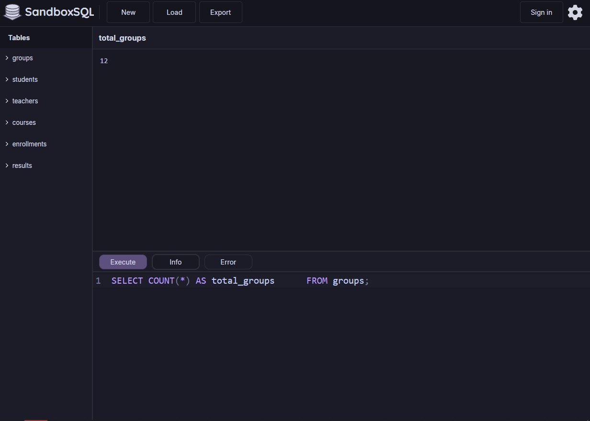
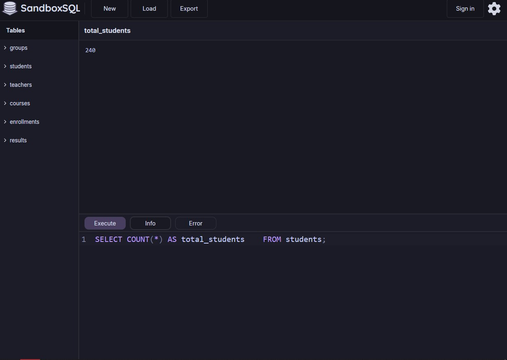
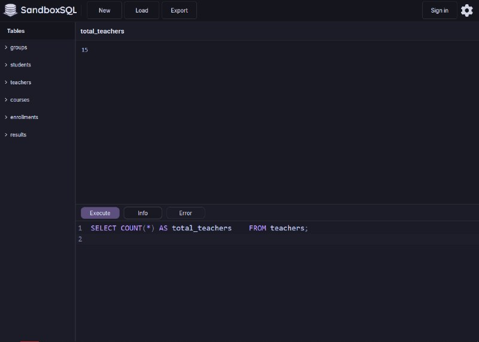
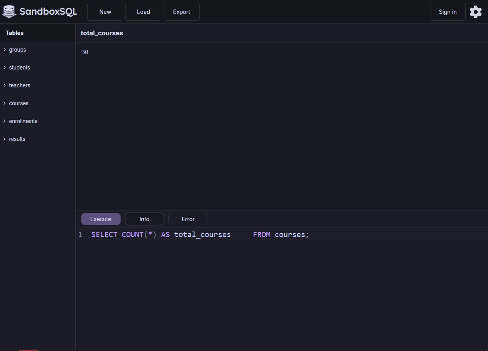
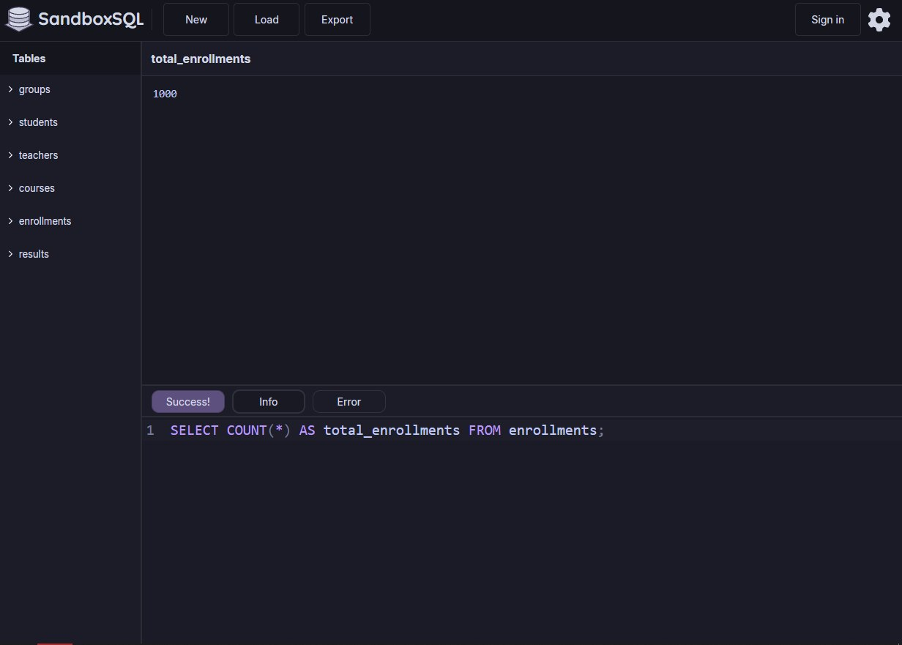
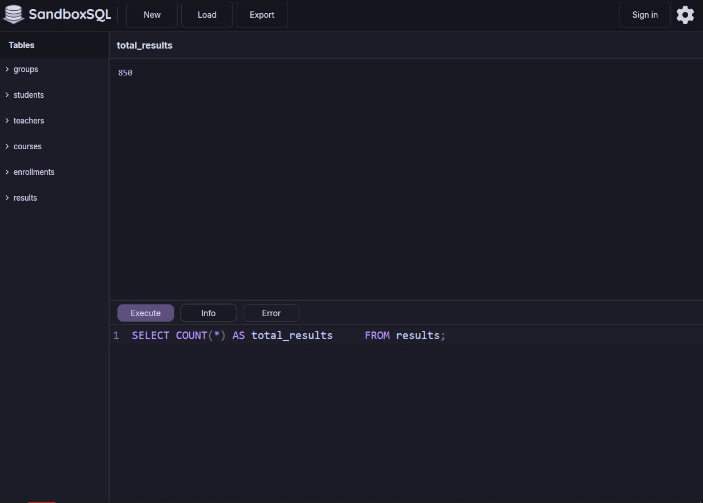

| Таблица | Ожидается | Получено |
|---|---|---|
| groups | 12 | 12 |
| students | 240 | 240 |
| teachers | 15 | 15 |
| courses | 30 | 30 |
| enrollments | 1000 | 1000 |
| results | 850 | 850 |

**Объяснение:** все значения совпали с контрольными, значит выбран правильный файл и можно продолжать работу.

---

## Шаг 2. Изучение структуры и аналитические вопросы

**Цель:** понять, что хранится в таблицах и как они связаны.

```sql
SELECT * FROM students LIMIT 5;
SELECT * FROM enrollments LIMIT 5;
PRAGMA table_info(enrollments);
```

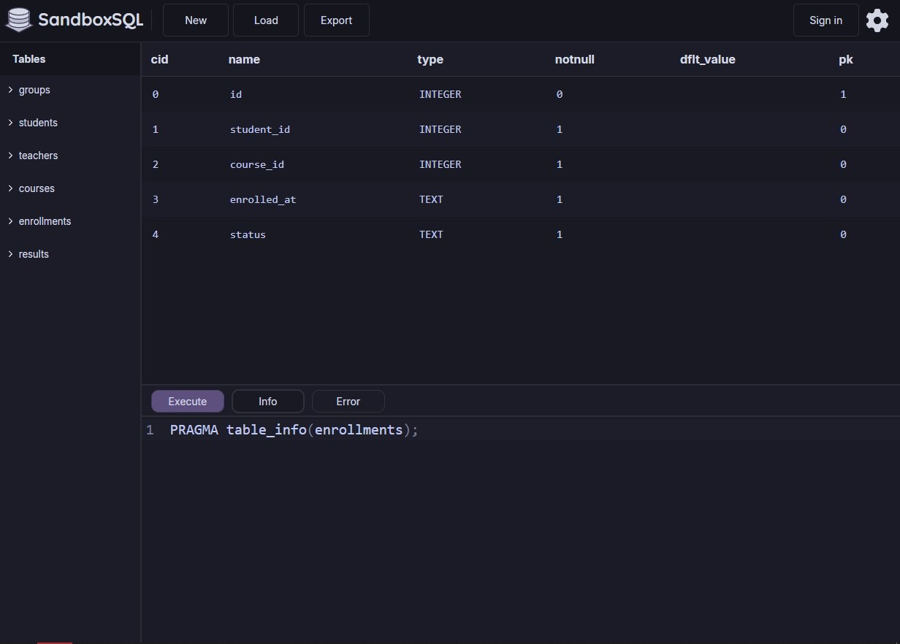

### Описание таблиц

| Таблица | Назначение | Первичный ключ | Внешние ключи |
|---|---|---|---|
| groups | учебные группы (`group_name`, `study_year`) | id | нет |
| students | студенты (`full_name`, `admission_year`) | id | `group_id → groups.id` |
| teachers | преподаватели (`full_name`, `department`) | id | нет |
| courses | курсы (`course_name`, `hours`) | id | `teacher_id → teachers.id` |
| enrollments | записи студентов на курсы (`enrolled_at`, `status`) | id | `student_id → students.id`, `course_id → courses.id` |
| results | итоговые оценки (`score`, `completed_at`) | id | `enrollment_id → enrollments.id` |

### Связи

- Студент и курс связаны через `enrollments`: одна строка этой таблицы означает «студент X записан на курс Y». Это связь «многие ко многим».
- К записи на курс привязан результат через `results.enrollment_id → enrollments.id`. У записи может быть один результат или ни одного (оценка есть только у завершённых записей).
- Чтобы получить оценку по курсу, нужна цепочка `results → enrollments → courses`.

### Аналитические вопросы

1. Сколько всего записей на курсы хранится в базе? → `enrollments` → количество строк.
2. Сколько курсов закреплено за каждым преподавателем? → `teachers`, `courses` → `COUNT(courses.id)` по преподавателю.
3. Сколько записей имеют каждый из статусов (`completed`, `active`, `cancelled`)? → `enrollments` → `COUNT(*)` по `status`.
4. Сколько студентов в каждой учебной группе? → `groups`, `students` → `COUNT(students.id)` по группе.
5. Какова средняя продолжительность курса? → `courses` → `AVG(hours)`.
6. Сколько оценок хранится по каждому курсу? → `courses`, `enrollments`, `results` → `COUNT(results.id)` по курсу.
7. **(Вариант 5)** Какие учебные курсы отличаются наибольшим разбросом оценок (`MAX(score) − MIN(score)`)? → `courses`, `enrollments`, `results` → `MAX(score) − MIN(score)` по курсу.

---

## Шаг 3. Фильтрация и сортировка

### Запрос 3.1. Курсы длительностью не менее 60 часов

**Цель:** отобрать длинные курсы и упорядочить их по убыванию длительности, затем по названию.

```sql
SELECT id, course_name, hours, teacher_id
FROM courses
WHERE hours >= 60
ORDER BY hours DESC, course_name;
```

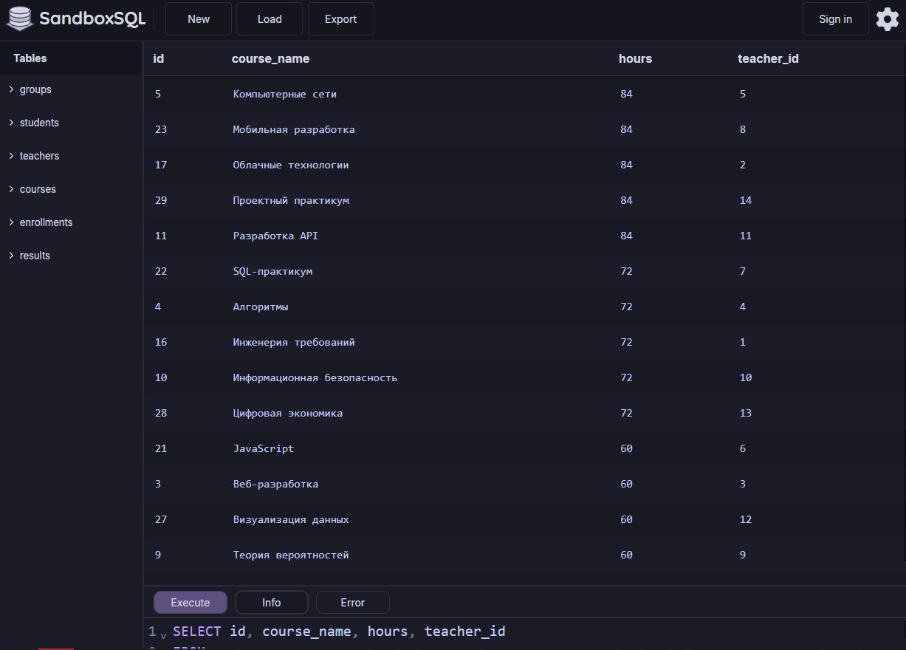

**Объяснение:** `WHERE` оставляет только курсы с `hours >= 60`, `ORDER BY` сортирует сначала по часам (от большего к меньшему), а при равенстве по названию. Получено 15 курсов, самый длинные (5 курсов): Компьютерные сети, Мобильная разработка, Облачные технологии, Проектный практикум, Разработка API ( 84 ч).

### Запрос 3.2. Студенты, поступившие в 2025 году

**Цель:** вывести первых 10 студентов 2025 года поступления в алфавитном порядке.

```sql
SELECT id, full_name, group_id, admission_year
FROM students
WHERE admission_year = 2025
ORDER BY full_name
LIMIT 10;
```

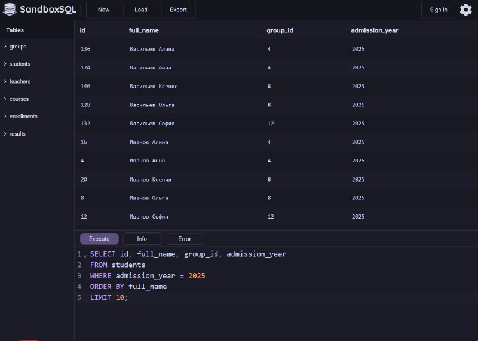

**Объяснение:** условие `admission_year = 2025` отбирает нужный набор, сортировка по `full_name` даёт алфавитный порядок, а `LIMIT 10` обрезает вывод до десяти строк.

---

## Шаг 4. Агрегирование и группировка

### Запрос 4.1. Общее количество записей на курсы

```sql
SELECT COUNT(*) AS total_enrollments FROM enrollments;
```

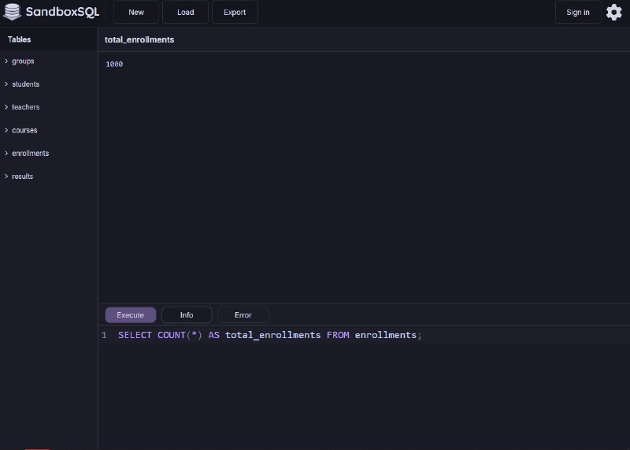

**Объяснение:** получено 1000 (ожидается 1000).

### Запрос 4.2. Статистика по длительности курсов

```sql
SELECT MIN(hours) AS min_hours,
       MAX(hours) AS max_hours,
       ROUND(AVG(hours), 2) AS avg_hours,
       SUM(hours) AS total_hours
FROM courses;
```

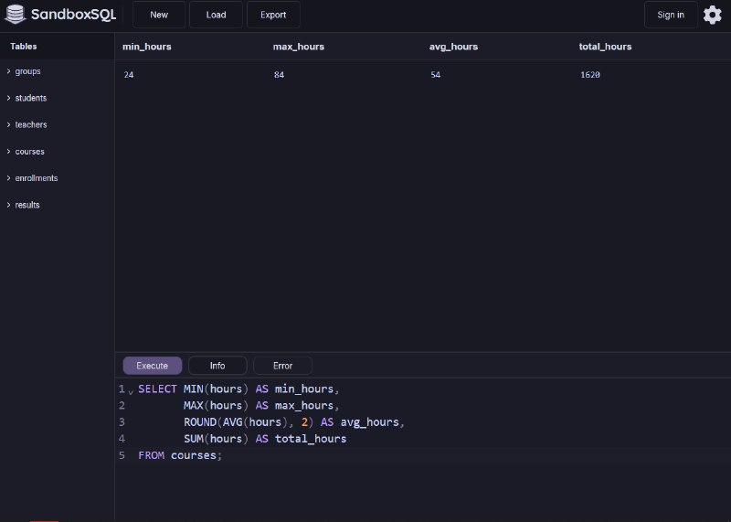

**Объяснение:** минимум 24 ч, максимум 84 ч, среднее 54 ч, суммарно 1620 ч по всем 30 курсам.

### Запрос 4.3. Записи по статусам (только статусы с количеством более 100)

```sql
SELECT status, COUNT(*) AS total
FROM enrollments
GROUP BY status
HAVING COUNT(*) > 100
ORDER BY total DESC;
```

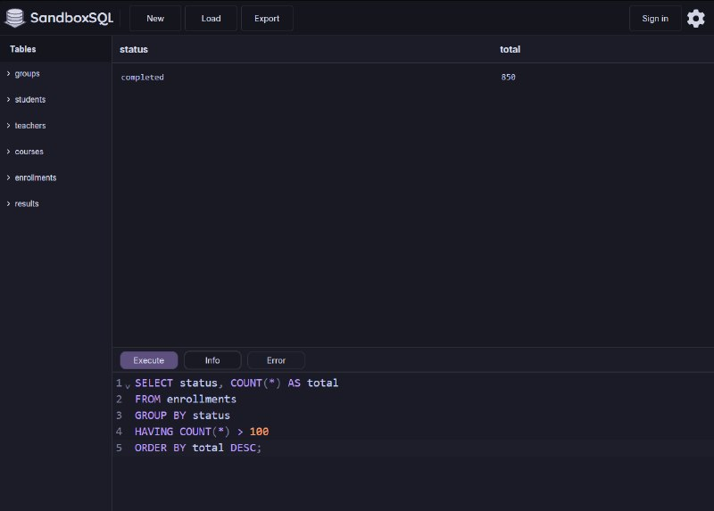

**Объяснение:** `GROUP BY` считает записи отдельно для каждого статуса, `HAVING` оставляет только группы, где количество больше 100. Сумма по всем трём статусам (без `HAVING`) равна 1000: completed 850, active 100, cancelled 50.

### Разница между WHERE и HAVING

`WHERE` фильтрует отдельные строки до группировки и не может использовать агрегатные функции. `HAVING` фильтрует уже сформированные группы по рассчитанным значениям, например `COUNT(*) > 100`.

---

## Шаг 5. Соединение таблиц

### Запрос 5.1. Студенты и их группы (INNER JOIN)

```sql
SELECT s.id, s.full_name, g.group_name
FROM students AS s
INNER JOIN groups AS g ON g.id = s.group_id
ORDER BY s.id
LIMIT 10;
```

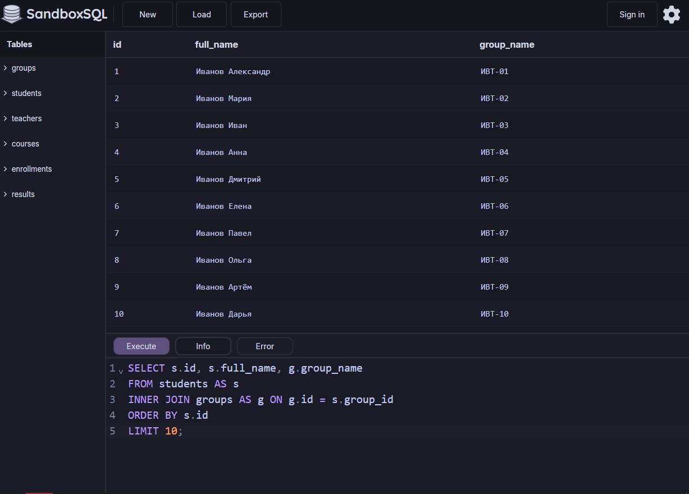

**Объяснение:** каждому студенту по `group_id` подбирается строка из `groups`. Выведено 10 строк.

### Запрос 5.2. Курсы и преподаватели (INNER JOIN)

```sql
SELECT c.id, c.course_name, t.full_name AS teacher_name
FROM courses AS c
INNER JOIN teachers AS t ON t.id = c.teacher_id
ORDER BY c.id
LIMIT 10;
```

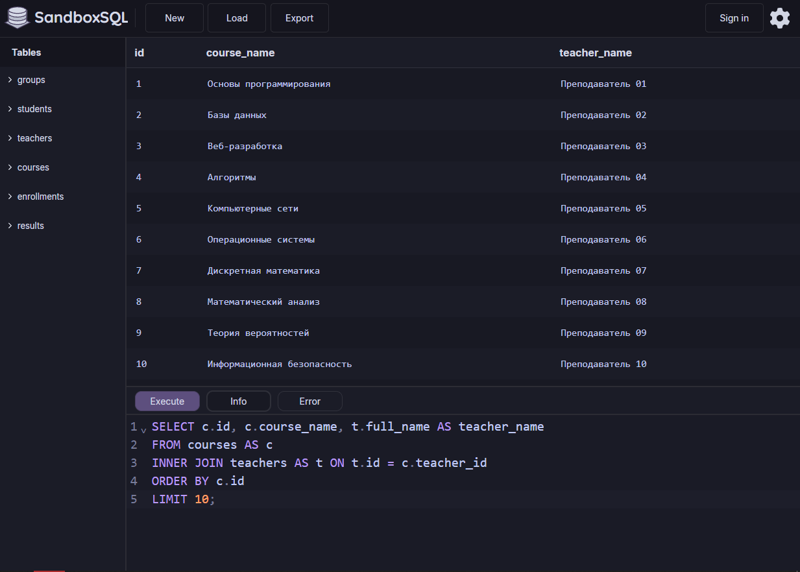

**Объяснение:** связь идёт по `courses.teacher_id = teachers.id`, выведено 10 строк.

### Запрос 5.3. Все преподаватели и их курсы (LEFT JOIN)

```sql
SELECT t.id, t.full_name, c.id AS course_id, c.course_name
FROM teachers AS t
LEFT JOIN courses AS c ON c.teacher_id = t.id
ORDER BY t.id, c.id;
```

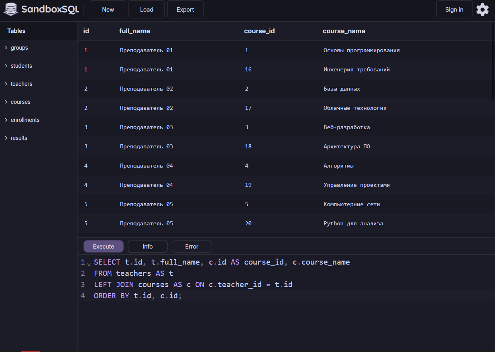

Проверка, что все 15 преподавателей присутствуют:

```sql
SELECT COUNT(DISTINCT t.id) AS teachers_in_output
FROM teachers AS t
LEFT JOIN courses AS c ON c.teacher_id = t.id;
```

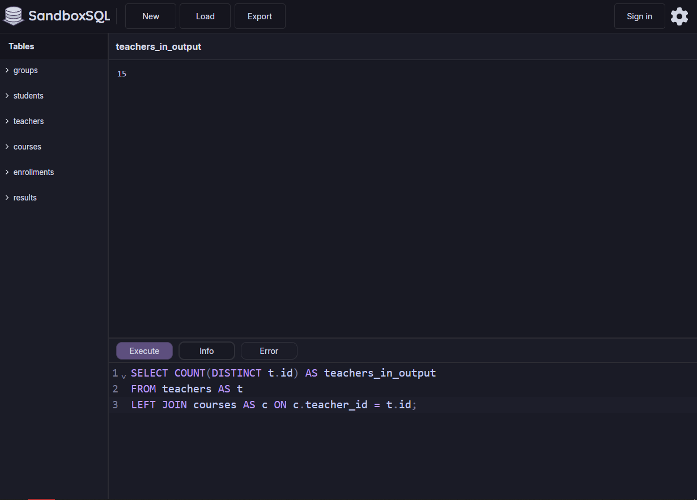

**Объяснение:** получено `teachers_in_output = 15` (ожидается 15). Строк в основном выводе ___, то есть больше 15, потому что преподаватель, ведущий несколько курсов, повторяется по одной строке на каждый курс. Если курсов у преподавателя нет, поля курса будут `NULL`.

### Разница между INNER JOIN и LEFT JOIN

`INNER JOIN` оставляет только строки, у которых есть пара в обеих таблицах. `LEFT JOIN` сохраняет все строки левой таблицы, а недостающие значения справа заполняет `NULL`.

---

## Шаг 6. Проверка корректности

### Запрос 6.1. Некорректные оценки

```sql
SELECT COUNT(*) AS invalid_scores
FROM results
WHERE score < 0 OR score > 100 OR score IS NULL;
```

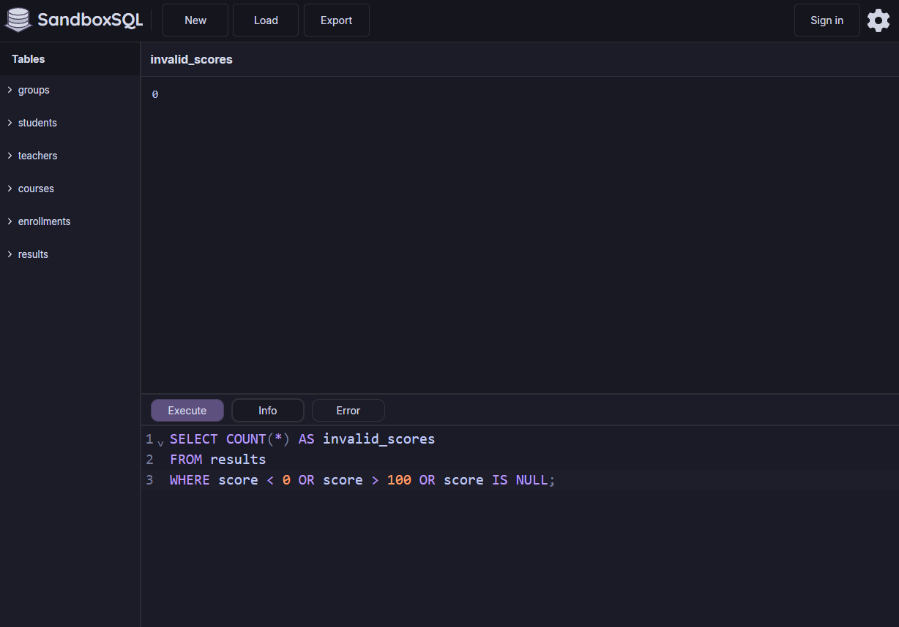

### Запрос 6.2. Оценки без соответствующей записи на курс

```sql
SELECT COUNT(*) AS orphan_results
FROM results AS r
LEFT JOIN enrollments AS e ON e.id = r.enrollment_id
WHERE e.id IS NULL;
```

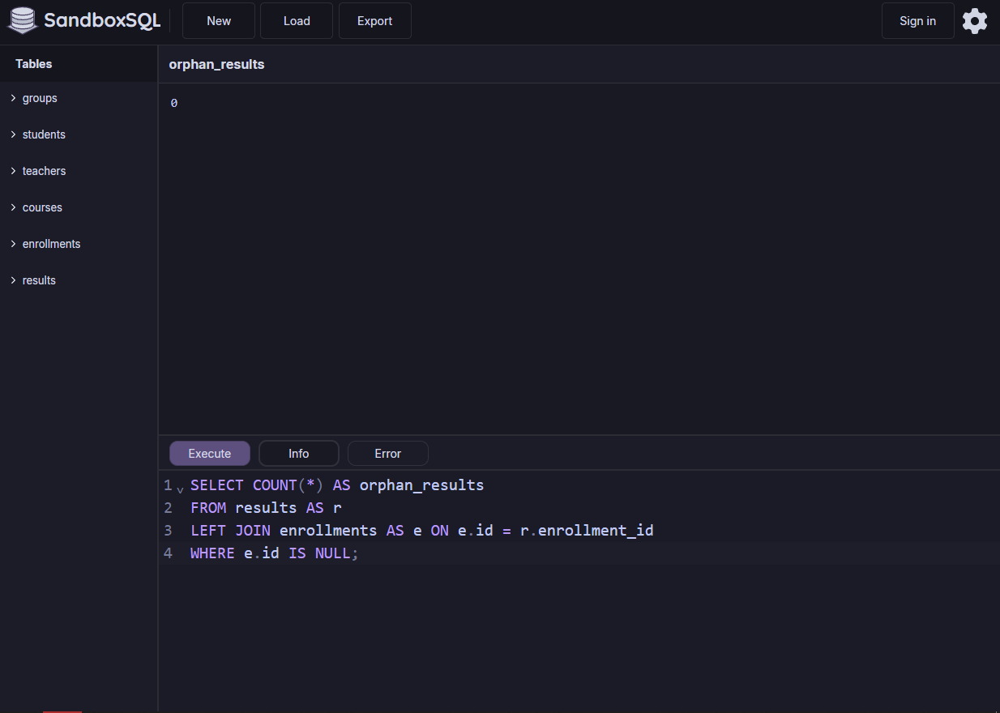

### Итоги проверок

| Проверка | Ожидаемое значение | Полученное значение | Итог |
|---|---|---|---|
| Оценки вне диапазона 0–100 или NULL (`invalid_scores`) | 0 | 0 | совпало |
| Оценки без записи в `enrollments` (`orphan_results`) | 0 | 0 | совпало |
| Количество записей в `results` | 850 | 850 | совпало |

---

## Шаг 7. Индивидуальное исследование (вариант 5)

**Вопрос варианта 5:** Какие курсы отличаются наибольшим разбросом оценок (`MAX(score) − MIN(score)`)?

### Таблицы, ключи и показатели

- Таблицы: `courses`, `enrollments`, `results`.
- Ключи соединения: `enrollments.course_id = courses.id` и `results.enrollment_id = enrollments.id`.
- Показатель: разброс `MAX(score) − MIN(score)` по каждому курсу. Дополнительно считаются число оценок и средняя оценка, чтобы корректно интерпретировать разброс.
- Используется `INNER JOIN`, так как курсы без оценок разброса не имеют.

### Запрос 7.1. Основной: топ-10 курсов по разбросу оценок

**Цель:** посчитать для каждого курса минимальную и максимальную оценку и их разность.

```sql
SELECT c.id,
       c.course_name,
       COUNT(r.id)                  AS scores_count,
       MIN(r.score)                 AS min_score,
       MAX(r.score)                 AS max_score,
       MAX(r.score) - MIN(r.score)  AS score_range
FROM courses AS c
INNER JOIN enrollments AS e ON e.course_id = c.id
INNER JOIN results AS r ON r.enrollment_id = e.id
GROUP BY c.id, c.course_name
ORDER BY score_range DESC, scores_count DESC
LIMIT 10;
```

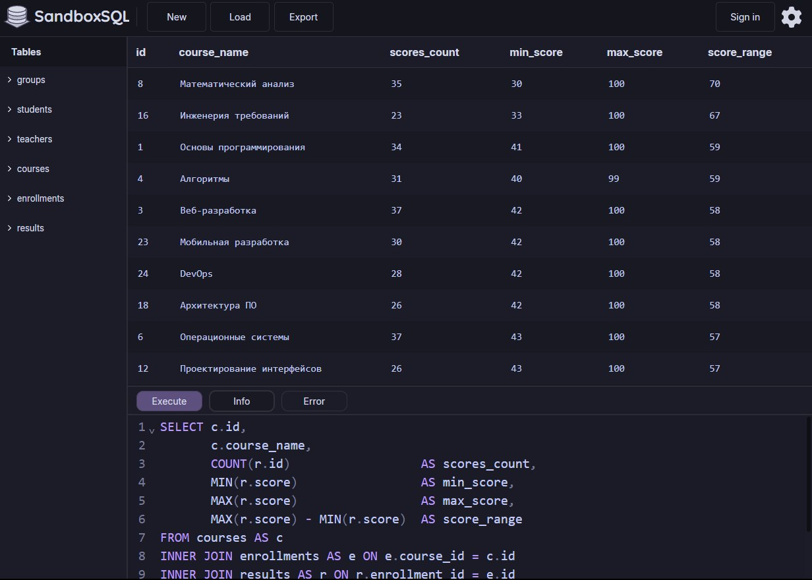

**Объяснение:** наибольший разброс у курса «Математический анализ»: min = 30, max = 100, разброс = 70 при 35 оценках. Следом идут «Инженерия требований» (67) и «Основы программирования» (59). Если у нескольких курсов одинаковый разброс, они упорядочены по числу оценок.

### Запрос 7.2. Уточняющий: разброс с учётом числа оценок и средней

**Цель:** проверить, не вызван ли большой разброс малым числом оценок. Берутся только курсы минимум с 10 оценками.

```sql
SELECT c.course_name,
       COUNT(r.id)                  AS scores_count,
       ROUND(AVG(r.score), 2)       AS avg_score,
       MAX(r.score) - MIN(r.score)  AS score_range
FROM courses AS c
INNER JOIN enrollments AS e ON e.course_id = c.id
INNER JOIN results AS r ON r.enrollment_id = e.id
GROUP BY c.id, c.course_name
HAVING COUNT(r.id) >= 10
ORDER BY score_range DESC, scores_count DESC
LIMIT 10;
```

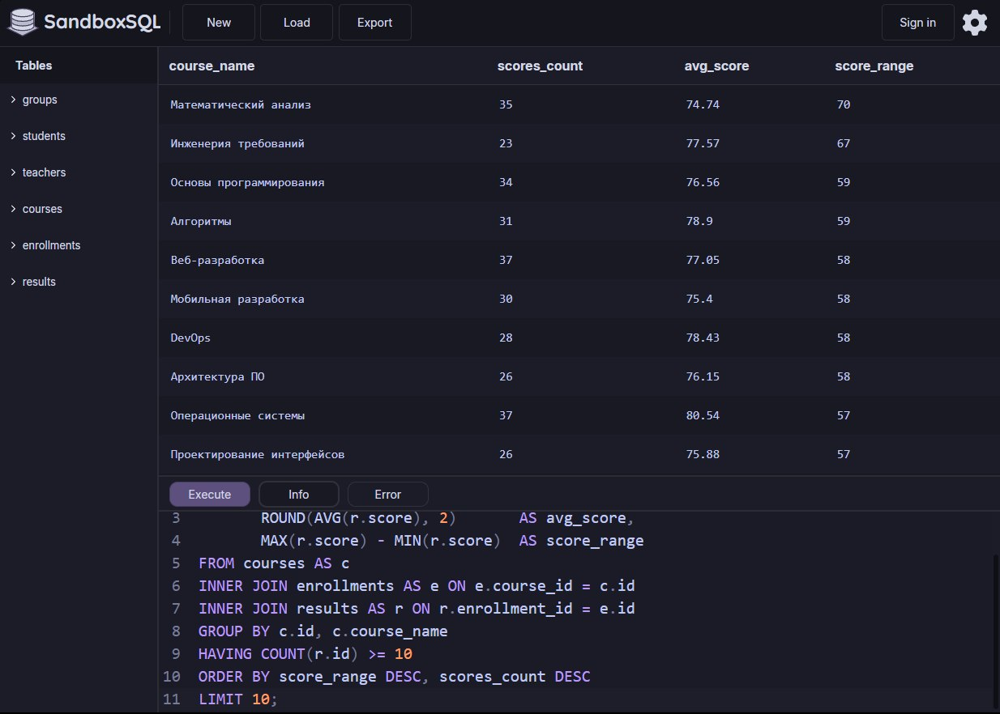

**Объяснение:** после фильтра лидер по разбросу: «Математический анализ» (разброс 70, 35 оценок, средняя 74.74). Состав топа не изменился по сравнению с запросом 7.1.

### Запрос 7.3. Проверочный: все оценки учтены

**Цель:** убедиться, что соединения не потеряли и не размножили оценки.

```sql
SELECT COUNT(*) AS joined_results
FROM results AS r
INNER JOIN enrollments AS e ON e.id = r.enrollment_id
INNER JOIN courses AS c ON c.id = e.course_id;
```

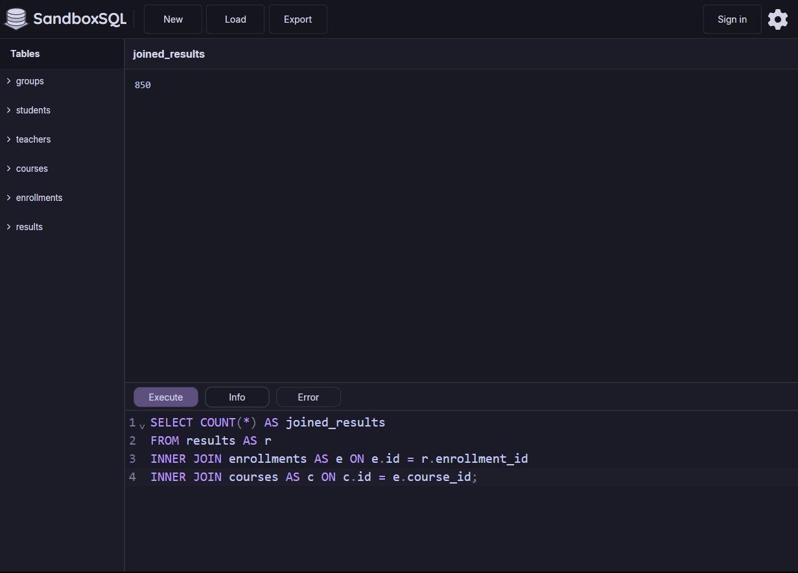

**Объяснение:** получено 850 , ожидается 850, то есть равно числу строк в `results`. Значит, цепочка соединений построена верно.

### Ответ на вопрос варианта

Наибольшим разбросом оценок отличаются курсы: **Математический анализ** (разброс 70), **Инженерия требований** (разброс 67), **Основы программирования** (разброс 59).

### Выводы

1. Самый большой разброс у курса «Математический анализ»: от 30 до 100 баллов (разброс 70), то есть результаты студентов на нём сильно различаются.
2. После отсечения курсов с малым числом оценок (`HAVING COUNT >= 10`) лидеры по разбросу не изменились, значит большой размах не связан с малым количеством оценок.
3. Курсы с одинаково высоким разбросом могут иметь разную среднюю оценку (например, «Основы программирования» и «Алгоритмы» имеют разброс 59, но средние 76.56 против 78.9), поэтому разброс нужно смотреть вместе со средним, а не вместо него.

### Ограничение анализа

Разброс `MAX − MIN` определяется только двумя крайними значениями и сильно зависит от единичных выбросов, а также от числа оценок на курсе: чем их больше, тем вероятнее встретить экстремальные значения. Он не показывает, как распределена основная масса оценок. Для более надёжной картины нужны дополнительные показатели, например среднее и стандартное отклонение.
